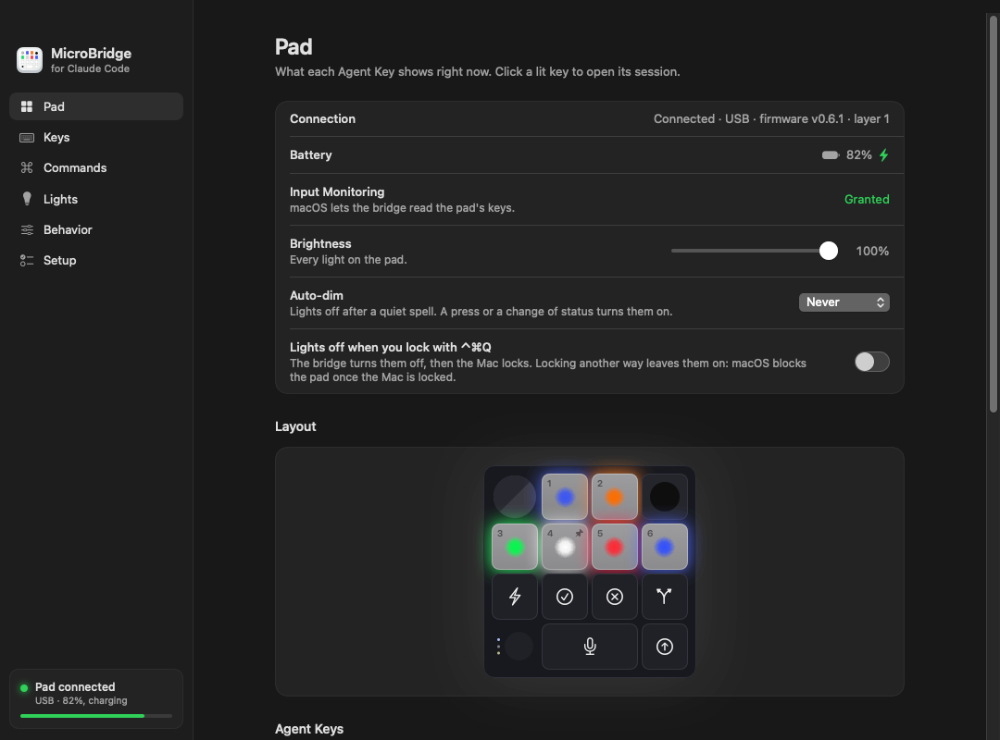
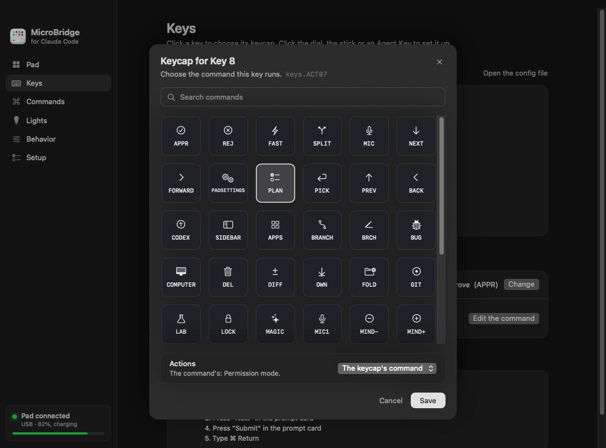
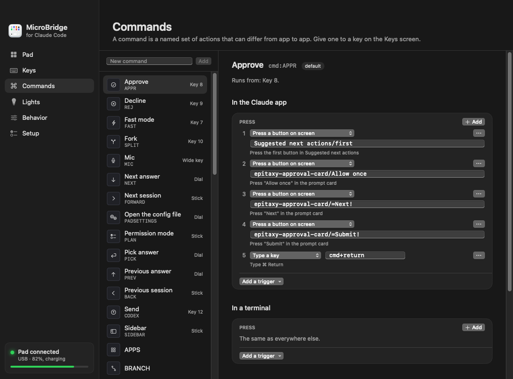

# MicroBridge

Drives the Codex Micro keypad from Claude Code on macOS. Each of the six Agent Keys follows one
Claude Code session and lights by what that session is doing. The command keys, dial and stick
approve, decline, fork, talk and move through Claude's question cards.

Website: [microbridge.philopateer.dev](https://microbridge.philopateer.dev) shows the pad, what
each control does and the install steps.

> **Unofficial.** The Codex Micro is made by Work Louder for OpenAI and ships working with
> ChatGPT and Codex. This project is not affiliated with, endorsed by or supported by OpenAI,
> Work Louder or Anthropic.

## What the pad does

| Control | What happens |
|---|---|
| Agent Keys (top six) | One per Claude Code session: blue working, amber needs you, green done and unread, white idle, red failed. The key of the session on screen in the Claude app pulses slowly. |
| Tap an Agent Key | Clears its green or red and shows that session: its Code session in the Claude app, or the terminal it runs in. |
| Hold an Agent Key | Forgets its session and frees the key. |
| Pin a session | It keeps its key, however urgent the others are, and after it ends. Pin and unpin in the window, with `micro ctl pin`, or with a double tap once `agentKeys.doubleTap` is `pin`. |
| A session that ended | A Claude app session keeps its key, and a tap opens it again. Keys also survive a restart of the bridge. |
| More than six sessions | The six most urgent hold the keys: needs you first, then done or failed, then working, then idle. The session on screen keeps its key. |
| Tap a dark Agent Key | Nothing. Bind a key to `cmd:NEW` to start sessions from the pad. |
| Approve, Decline | Press the front session's next-step button, "Allow once", "Deny", or a question card's Next, Submit or Skip. In a terminal: Return or Esc. |
| Fork, Fast, Codex | `/branch` or a new chat, `/fast`, send the message. |
| Mic (wide key) | Hold to talk. |
| Dial | On a question card, turn to move between answers and press to tick or submit. Elsewhere, Up and Down, and Return. Hold to open the config file. |
| Stick | Permission mode, previous and next session, sidebar. Up and down can scroll what is under the pointer instead, and left and right move the pointer between panes, such as the chat and a web page. |

Every control can be rebound to any of 49 named commands, a key combination, typed text, a shell
command or something to open, on press, release, double tap or hold. See
[docs/configuration.md](docs/configuration.md). What is built and what is not, control by
control: [docs/features.md](docs/features.md).

## The window



Open MicroBridge from `~/Applications`. The sessions in the picture are made up.

| Screen | What it does |
|---|---|
| Pad | The pad's connection, battery and Input Monitoring, its brightness, auto-dim and whether ⌃⌘Q turns the lights off before the Mac locks. The six Agent Keys as the pad shows them, the session on each key, and the sessions waiting for one. Click a key to open its session. Pin a session to its key or to another key. Forget a session to free its key. |
| Keys | Click a key on a drawing of the pad to open its keycap dialog: search the commands, pick one from a grid of keycaps, then Save. Or give the key its own actions: an ordered list for a press, a release, a double tap and a hold. The dial, the stick and the Agent Keys are set up under the drawing. Each control's actions are listed in plain words, for the Claude app and for a terminal. |
| Commands | Every command and what it does in the Claude app, in a terminal and everywhere else. Change its actions, or make a command of your own and give it to a key. |
| Lights | The color of each state, brightness, auto-dim, the lock and the pulse. |
| Behavior | Which sessions hold the keys, how long an ended session keeps its key, and the warnings. |
| Setup | One check each for the bridge, the two macOS permissions, the Claude Code hooks, the config file and the pad, with the next step to take and the end of the log. |

The window changes `config.json`, and the bridge picks the change up within a second. Before its
first change it copies the file to `config.json.before-app`. A change the bridge would refuse is
not written. An action you type is saved when you press Return or its Save button, so a
half-typed one never reaches a key. A keycap you pick is saved when you press Save in its dialog. Closing the window does not stop the bridge.





## How it works

```
 Claude Code ──hooks──► micro hook ──socket──► micro daemon ──HID──► Codex Micro
                                                    │        ◄── key, dial and stick events
                                                    └──► keystrokes, on-screen buttons, Claude app links
```

1. `micro hook` is a Claude Code command hook. It reads the hook's JSON on stdin, reports the
   session's status to the daemon and exits 0 without printing, so tool calls are not slowed down.
2. The daemon runs as a LaunchAgent and drives the pad. It shares it with ChatGPT and Work Louder
   Input, which keep it open too. While ChatGPT is in front the bridge lights nothing and acts
   on no key; in any other app its lights win (`stepAsideFor`). It sends only an allowlist of
   read and lighting methods, never anything that writes the pad's storage or firmware, and
   reconnects after an unplug.
3. Optional: MicroBridge Helper, a small root program, keeps the pad from ChatGPT while ChatGPT
   is behind another app, since macOS lets only root do that. See
   [Keeping ChatGPT out](#keeping-chatgpt-out).
4. Key events become actions. Keystrokes go to the app in front, or only to the apps listed in
   `keystrokeApps` when that list is set. Buttons in the Claude app are found and pressed
   through the Accessibility API.
5. The window is the same program started with no command. It asks the daemon for its state
   once a second over the socket and never opens the pad itself.

The pad speaks JSON-RPC-style messages carried in 64-byte HID reports. The design and its dated
build log are in [docs/development-log.md](docs/development-log.md).

## Development

Built from 2026-11-10 against a real pad on firmware v0.6.1 (0.6.3 since 2026-11-22). Each
behavior below was checked on the hardware or in the daemon's log, and the fixes are covered
by the test suite (276 tests).

- **Mapping the pad.** Every key, the dial and the stick were captured through the daemon. The
  wide bottom key sits on two switches and sends two events about 6 ms apart. The dial sends
  both directions, but not every detent arrives, and a turn to the right arrives as
  counter-clockwise, so the defaults bind it the other way round.
- **Sharing the pad.** ChatGPT, Work Louder Input and MicroBridge can all hold the pad open at
  once, and every app receives every reply. Replies are matched on their id and on the method
  they echo. Lighting goes to whichever app wrote last. An exclusive open is refused as not
  privileged, so the bridge steps aside while ChatGPT is in front and, in any other app, paints
  over ChatGPT's light writes as soon as the pad answers them. Run as root, the exclusive open
  works: ChatGPT then hears nothing, retries every 10 seconds, and reopens the pad about 3
  seconds after it is shared again.
- **The bridge went deaf.** 39 seconds after a restart it stopped reacting to keys while the pad
  kept answering. One line that never parsed made every later line pile onto it, up to 16 KiB.
  Now a later line that parses on its own replaces the stuck text, and text is dropped after
  four lines, with a log line saying what was dropped.
- **Turns stopped by hand.** Claude Code fires no hook when a turn is stopped with Escape or a
  declined prompt, so a key stayed amber. The hook now passes the session's transcript path,
  and once a second the daemon reads the end of each waiting session's transcript. A stopped
  session went idle within 2.5 seconds in testing.
- **The dial on question cards.** The dial moves between a card's answers in the Claude app
  through the Accessibility API. The first press on a fresh card only moves keyboard focus, so a
  press repeats every quarter second, for up to a second, until the app shows it. Keeping the
  card it found for five seconds cut each step from 120 ms and 1,590 elements searched to 2 ms
  and 14.
- **Keys forgot their sessions.** When a session ended or the bridge restarted, its key went
  dark, and the next press opened a new chat. Now a Claude app session that ends keeps its key
  and a tap opens it again. The keys are saved every 5 seconds and restored at start.
- **More than six sessions.** The six most urgent sessions hold the keys. A waiting session
  takes the key of a less urgent one. The session on screen and a key pressed in the last
  5 seconds are left alone. Seen with eight real sessions on 2026-11-18: six held keys and two
  waited.
- **What counts as read.** A green or red key clears when you act on its session: a tap on the
  key, a new prompt, or a pad key that presses a button in it. Looking at the session does not
  clear it.
- **A window without Xcode.** The window is SwiftUI, built by the Command Line Tools alone. Their
  compiler has no plugin for `@State`, so the window keeps its state in plain observable objects.
  Every screen is drawn to a PNG file without opening a window (`micro snapshot`), which is how
  the layout was checked. The window's changes to the config file are covered by 43 tests.
- **Actions you can type.** The window edits every list of actions and every command. A field
  is saved with Return or its Save button and only when the bridge would take it, so a key never
  runs half a shell command. Two of the tests type into the real fields, in a window that is
  never shown.
- **Pins.** With more than six sessions the most urgent hold the keys, so a session could lose
  the key you had learned to find it on. A pinned session keeps its key until you unpin or
  forget it. The pin is on the Claude app session: when the Claude Code session inside it ends
  and a new one starts, the new one has the same key and the same pin. Tried on the running
  bridge with a made-up session on 2026-11-19.

Still open: Bluetooth is untested. Once, after 29 idle minutes, the pad stopped answering over
USB, for ChatGPT as well, until the cable was replugged. The kernel's HID counters (`ioreg`) are
how that is being tracked. The low-battery warning is built but has never fired, because the pad
charges over USB.

## Requirements

- macOS 14 or later and Swift 6.0 or later: Xcode 16, or just the Command Line Tools
  (`xcode-select --install`, which `git` also asks for on a new Mac)
- A Codex Micro over USB, on its first layer (the one with the Codex keys). Bluetooth is untested.
- Input Monitoring and Accessibility access for MicroBridge.app

## Install

```sh
git clone https://github.com/Philopateer2099/micro-bridge.git && cd micro-bridge
scripts/make-cert            # optional: a local signing identity, so macOS keeps the
                             # Input Monitoring grant across rebuilds
scripts/install              # builds MicroBridge.app into ~/Applications, starts it at login
scripts/claude-hooks install # adds the hook to ~/.claude/settings.json (backs it up first,
                             # or creates it if Claude Code has not made one yet)
scripts/micro access         # shows Input Monitoring and Accessibility, asks for what is missing
open ~/Applications/MicroBridge.app   # the window; its Setup screen says what is still missing
```

`scripts/claude-hooks` runs the app's own `micro hooks`. It touches only MicroBridge's entries,
and `--dry-run` says what it would change first. Instead of the hook in your settings, you can
use the MicroBridge plugin for Claude Code: in a session, run
`/plugin install micro-bridge --marketplace Philopateer2099/micro-bridge` (or
`/plugin marketplace add Philopateer2099/micro-bridge`, then `/plugin install
micro-bridge@micro-bridge`). Use one or the other: each checks for the other, so an event never
reaches the bridge twice.

If the pad stays dark after you grant access, restart the bridge:
`launchctl kickstart -k "gui/$(id -u)/local.micro-bridge"`.

Check it: `scripts/micro ctl state` shows what each key shows and whether the pad is connected.
The log is `~/Library/Logs/micro-bridge.log`.

To remove it, run `scripts/claude-hooks remove` and then `scripts/uninstall`. The second stops
the daemon and removes the app, the login item and the config. The signing identity
("MicroBridge Local Signing" in Keychain Access) and the two entries in System Settings stay
until you remove them. If you installed MicroBridge Helper, remove it first with
`sudo scripts/helper remove`.

## Keeping ChatGPT out

ChatGPT acts on the pad's keys even while another app is in front, and it has no setting
against that. Only a program running as root can keep the pad from it. MicroBridge Helper is
that program, and it is optional. With it, while ChatGPT runs behind another app, MicroBridge
holds the pad and ChatGPT hears nothing. With ChatGPT in front, the pad is shared again, and
ChatGPT picks it back up within seconds.

```sh
sudo scripts/helper install   # asks for your password; from a download:
                              # sudo /Applications/MicroBridge.app/Contents/Resources/helper install
```

Then open System Settings > Privacy & Security > Input Monitoring, press +, and add
`/Library/PrivilegedHelperTools/MicroBridge Helper.app`. macOS does not let a root program add
itself to that list. The bridge moves over to the helper within half a minute; its log says
"through MicroBridge Helper". `scripts/helper status` shows whether it runs, and
`sudo scripts/helper remove` takes it all out again.

What it does and does not do:

- It opens only the Codex Micro, and only while MicroBridge is connected to it. When
  MicroBridge quits, the pad is shared again at once.
- It writes only the five methods listed under Safety and privacy. It checks each request and
  rebuilds it before writing it.
- It serves only your account, and only a program signed as MicroBridge with the same
  certificate as the helper.
- It holds the pad only on its first layer. On other layers the pad types like a keyboard, and
  a held keyboard types nothing. If the pad sends keyboard or mouse input while held, the pad
  is shared at once and that first input is lost.
- It makes no network connections. Its log, `/Library/Logs/micro-bridge-helper.log`, says when
  MicroBridge connected and when the pad was held or shared, never what was pressed.

### Passing the pad to ChatGPT

Both apps use the same keys. The Codex keys exist only on the pad's layer 1, and Work Louder
Input offers none for other layers, so out of the box no layer can be ChatGPT's. Two taps on
the pad's touch sensor (its bottom-left edge) pass the pad instead. Turn on "Two taps pass the
pad to ChatGPT" on the window's Behavior tab, or set `"layers": {"2": "com.openai.codex"}`.

1. Tap the touch sensor. The pad goes to layer 2.
2. Wait about a second for the notification "ChatGPT has the pad".
3. Tap again. The pad is back on layer 1, and its keys are ChatGPT's.

The same two taps give the pad back to MicroBridge.

- Until the first visit MicroBridge keeps the pad, also while ChatGPT is in front. With the
  helper, ChatGPT hears nothing; without it, ChatGPT hears the keys too.
- While ChatGPT has the pad, MicroBridge lights nothing and acts on no key, whatever app is in
  front. It turns its six Agent Key lights off as it lets go and leaves the ring and the key
  backlight as they are. After a hold, ChatGPT can take up to 10 s to open the pad again.
- ChatGPT gets the pad only while it is open. Quitting it gives the pad back, and so does a
  restart of MicroBridge. A pad that sleeps or loses its cable changes nothing.
- The pad does not say when its layer changes, so MicroBridge reads it once a second. A visit
  shorter than that goes unseen: stay on layer 2 until the notification comes. With
  `layerWarning` off there is no notification, and the log has the same lines.

#### One tap instead of two

The second tap is needed only because layer 2 has no Codex keys. Work Louder Input does not
offer them for a second layer, but it imports a profile file that has them. With such a profile
one tap is enough: on layer 2 ChatGPT has the pad, on layer 1 MicroBridge.

1. Stop MicroBridge: `launchctl bootout gui/$(id -u)/local.micro-bridge`. Input cannot write to
   a pad that MicroBridge Helper holds.
2. In Work Louder Input, export your profile. It saves `<name>-profile.json`. Keep that file
   as your backup.
3. In a copy of the file, give the second entry of `profile.layers` the same `layout` as the
   first, and give `profile.name` a new name.
4. In Input, import the copy. It arrives as a second profile. Select it. Your old profile
   stays as it was.
5. Start MicroBridge again (`scripts/install`, or log out and in) and turn on "Layer 2 has the
   pad's keys too" on the window's Behavior tab, or set `"layerKeys": true`.

- The layer the pad is on says who has it, also right after MicroBridge starts. The app in
  front does not matter.
- While ChatGPT is closed, MicroBridge acts on layer 2's keys too.
- MicroBridge reads the layer four times a second while ChatGPT is open, so a tap takes a
  quarter of a second to count. After a tap to layer 2, ChatGPT can take up to 10 s to open
  the pad again.
- To undo it, select your old profile in Input, delete the new one, and turn the setting off.

## Configure

The window's Keys, Commands, Lights and Behavior screens cover almost every setting. Everything is in one
file, `~/Library/Application Support/micro-bridge/config.json`, picked up within a second of
saving. Hold the dial to open it. A broken file is ignored and the last good settings stay.
`micro config check` says what is wrong, and `micro config show` lists what every control does.
Every action and setting: [docs/configuration.md](docs/configuration.md).

## Safety and privacy

- **The pad.** The bridge sends five methods to the pad and no others: `sys.version`,
  `device.status`, `v.oai.thstatus`, `v.oai.rgbcfg` and `lights.preview`.
- **The network.** The bridge makes no network connections. The hook and the daemon talk over
  a Unix socket in `~/Library/Application Support/micro-bridge`.
- **Input Monitoring** lets it read the pad's keys. **Accessibility** lets it type keys, press
  buttons in the app in front, and read the address of the Claude window to know which session
  is on screen.
- **Your sessions.** The bridge keeps each session's id, state, folder and process id, and
  reads the end of a waiting session's transcript. Nothing leaves the Mac.
- **MicroBridge Helper**, if you install it, runs as root. See
  [Keeping ChatGPT out](#keeping-chatgpt-out) for exactly what it may do.
- **`sh:` actions** run whatever command your config file names. The default file has one: it
  opens the config file.

Limits to know about: buttons in the Claude app are found by their accessibility labels and
class names, so a Claude app update can rename them. A session in a terminal gets a key and a
light, and a tap brings the app forward, not the tab. A Claude Code session started in an Orca
terminal is left alone on purpose.

To report a security problem: [SECURITY.md](SECURITY.md).

## Develop

```sh
swift build
scripts/test           # 276 tests; plain `swift test` works when Xcode is installed
scripts/micro listen   # print every key, dial and stick event
scripts/micro paint    # light the six Agent Keys in six states
scripts/micro app --demo   # the window with made-up sessions; it writes nothing
```

`.build/debug/micro snapshot <folder>` draws every screen of the window into PNG files, with
made-up sessions, or with `--live` as the bridge is right now.

`scripts/micro` runs a command inside MicroBridge.app, so macOS checks Input Monitoring for the
app rather than your terminal. Commands that open the pad directly (`listen`, `paint`, `set`,
`status`, `off`) need the daemon stopped first. `scripts/micro` with no command lists them all.

The landing page is one file with no build step: [site/index.html](site/index.html).

To send a change, read [CONTRIBUTING.md](CONTRIBUTING.md) first. What changed in each release:
[CHANGELOG.md](CHANGELOG.md).

## License

[MIT](LICENSE)
